# Muhammad Hassan

CS Student at FAST-NUCES | ML | DL | Backend

---

## About Me
- BS Computer Science – FAST-NUCES CFD Campus (7th Semester)
- Exploring Machine Learning and Deep Learning.
- Learning backend development with Python, FastAPI, and PostgreSQL.
- Interested in Machine Learning research, particularly Computer Vision.
- Email: m.hassan.x05@gmail.com

---

## Connect
- LinkedIn: https://linkedin.com/in/muhammad-hassan2005
- GitHub: https://github.com/MHassan05
- Kaggle: https://kaggle.com/mhassan2005
- LeetCode: https://leetcode.com/m_hassan_05

---

## Tech Stack
- **Languages:** Python, C/C++, SQL
- **Technologies:** FastAPI, PyTorch, Scikit-learn, SQLAlchemy, Pandas, NumPy, Pytest
- **Databases:** PostgreSQL, MySQL, SQL Server
- **Tools:** Git, GitHub, Linux, JupyterLab

---

## Top Languages

---

<!--## GitHub Streak

  

-->
